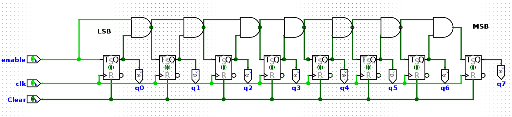
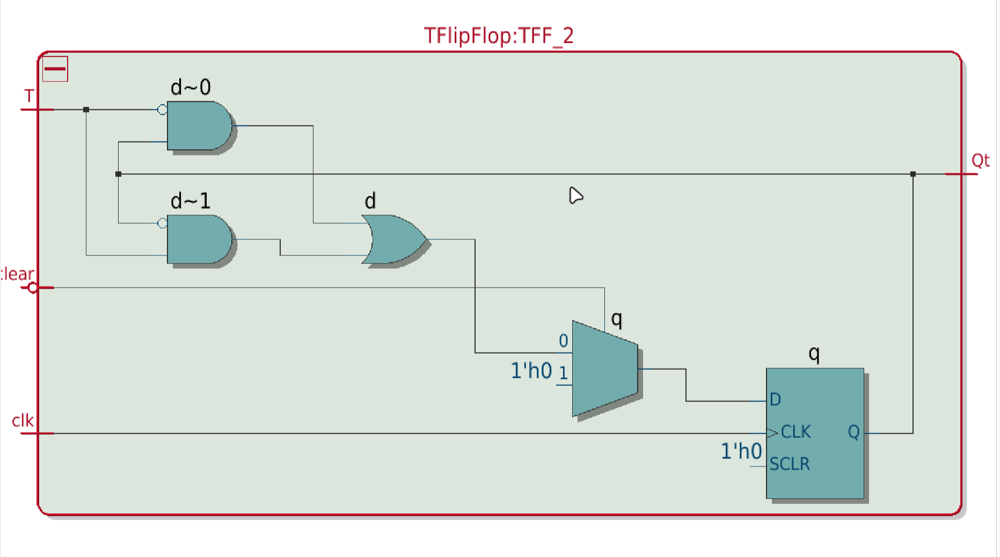
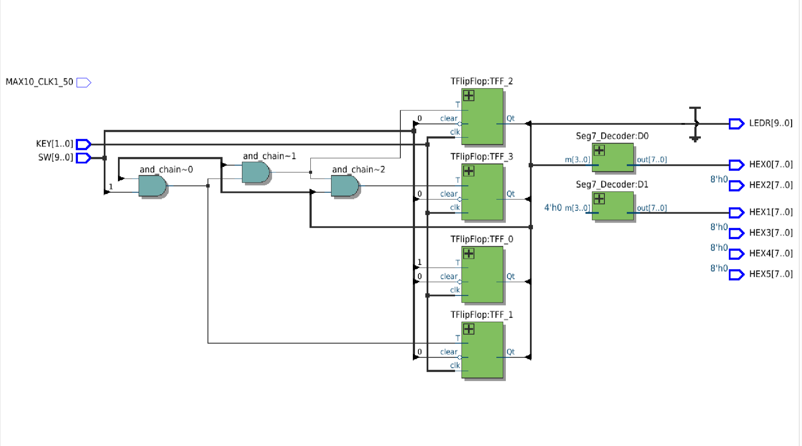
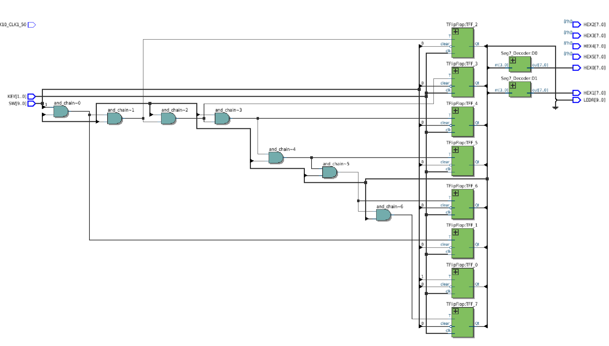
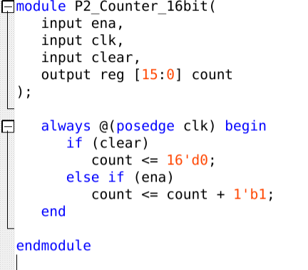
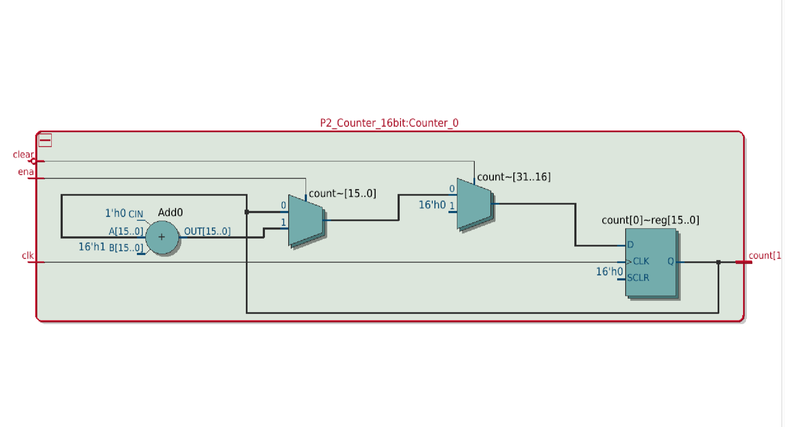
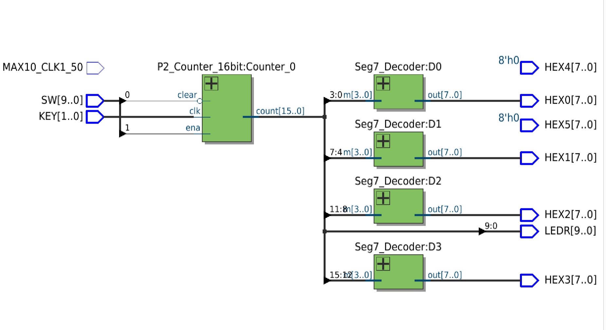
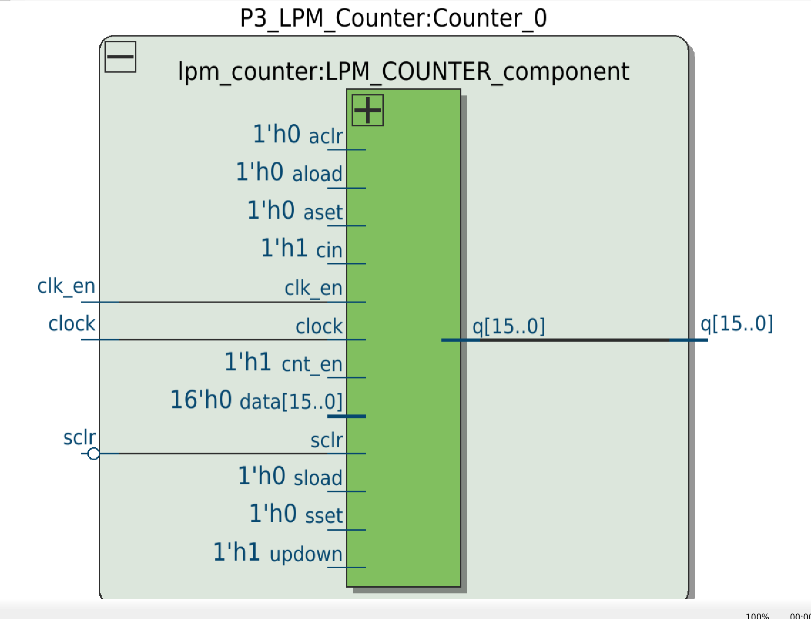
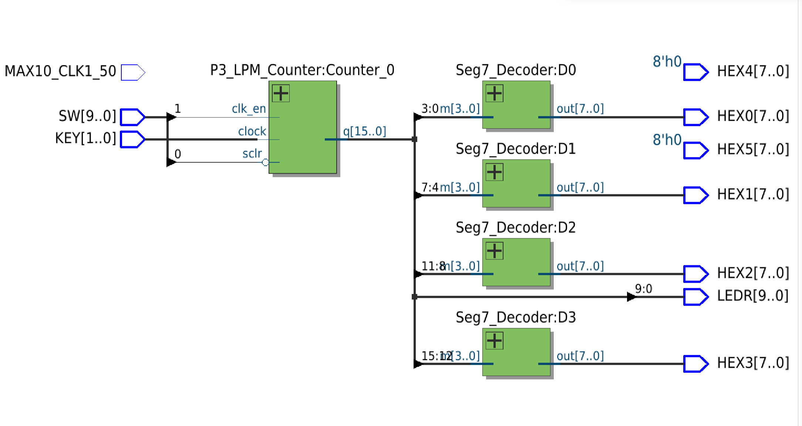

# Lab 4: Counters

Course: ENCE 3100 — Advanced Digital Design
Board: DE10-Lite

Notes:
- KEY0 as the clock makes the counter jump by 10-15 instead of 1. Same on KEY1, clean off the 50MHz crystal — extra clock edges from the button, not a logic bug.
- Seg7_Decoder from Lab 2 is BCD-only, so 10-15 display as 2-7. Rewrote it to cover 0-F.
- All three parts share the same `main.v` top level (clk = KEY[0], enable = SW[1], clear = ~SW[0], count on LEDR + HEX3..HEX0). Switching between parts just means swapping which counter module is instantiated.

---

## Part I — T Flip-Flop Counter

Built from the `TFlipFlop` module (`TFlopFlop.v`) — a D flip-flop with `d = (q & ~T) | (T & ~q)`, i.e. toggle when T is high, hold when it's low. `P1_Counter_8bit.v` chains eight of them into a **synchronous** counter: every TFF shares the same `clk`, and an AND chain builds the toggle-enable for each stage, so bit *n* toggles only when `ena` and all lower bits are 1.

```
and_chain[0] = ena & count[0]
and_chain[1] = and_chain[0] & count[1]
...
and_chain[6] = and_chain[5] & count[6]
```



Logisim model: eight T flip-flops sharing `clk` and `Clear`, with the AND chain across the top feeding each stage's T input. `enable` goes straight into the LSB's T, and the MSB (q7) toggles only when every bit below it is set.

_TODO:_



Netlist, inside one `TFlipFlop` instance: the toggle expression synthesizes to two inverted-input AND gates (`d~0`, `d~1`) feeding an OR (`d`) — the XOR written out in sum-of-products form. Note that `clear` is implemented as a 2:1 mux on the D input selecting `1'h0`, while the flop's own `SCLR` pin is tied to `1'h0` and left unused. That's because the clear is written inside the same `always @(posedge clk)` block as the data path, so Quartus folds it into the logic instead of mapping it onto the dedicated synchronous-clear input.

_TODO:_



Top-level netlist for the 4-bit version: four `TFlipFlop` instances, three AND gates in the carry chain, and only two `Seg7_Decoder` instances (D1 is fed a constant `4'h0`, so HEX1 always reads 0). HEX2–HEX5 are tied to `8'h0`.

_TODO:_



Top-level netlist for the 8-bit version: the same structure scaled to eight `TFlipFlop` instances and a seven-gate AND chain (`and_chain~0` through `and_chain~6`). The staircase layout of the chain is the giveaway that each stage's enable depends on every stage below it.

_TODO:_

### Board verification

_TODO:_

---

## Part II — Behavioral 16-bit Counter

Same function, written behaviorally instead of structurally. `P2_Counter_16bit.v` is one `always` block — no flip-flop module, no carry chain, the synthesizer infers all of it:

```verilog
always @(posedge clk) begin
    if (clear)
        count <= 16'd0;
    else if (ena)
        count <= count + 1'b1;
end
```





Netlist for `P2_Counter_16bit`: a single 16-bit adder (`Add0`, with `A = count`, `B = 16'h1`, `CIN = 1'h0`), a mux selecting between `count` and `count + 1` off `ena`, a second mux forcing `16'h0` off `clear`, and one 16-bit register `count[0]~reg[15..0]`. Same priority order as the source — clear wins over enable because its mux sits closer to the register.

Worth comparing against Part I: the behavioral version produces a carry-lookahead style adder instead of the hand-built ripple AND chain, so it's both shorter to write and better structured for wide counts. The `clear` handling is identical to Part I though — mux on D, dedicated `SCLR` tied off at `16'h0`.

_TODO:_



Top-level netlist: `count[15:0]` fans out to four `Seg7_Decoder` instances, one per nibble (3:0 → HEX0, 7:4 → HEX1, 11:8 → HEX2, 15:12 → HEX3), with `count[9:0]` also driving LEDR. HEX4/HEX5 tied to `8'h0`. `SW` supplies clear and ena; `KEY` supplies the clock.

_TODO:_

### Board verification

_TODO:_

---

## Part III — LPM Counter (Megafunction)

Third version of the same counter, this time generated with the MegaWizard instead of written by hand. `P3_LPM_Counter.v` wraps Altera's `lpm_counter` with `lpm_width = 16`, `lpm_direction = "UP"`, and `lpm_port_updown = "PORT_UNUSED"`, exposing only `clock`, `clk_en`, `sclr`, and `q[15:0]`.



Netlist inside `P3_LPM_Counter`: the `lpm_counter` component with every unused control input tied off — `aclr`, `aload`, `aset`, `sload`, `sset` at `1'h0`, `data` at `16'h0`, `cin`, `cnt_en` and `updown` at `1'h1` (updown = 1 meaning count up). Only `clock`, `clk_en` and `sclr` come from the ports.

The difference from Parts I and II: here `sclr` connects to the counter's **dedicated synchronous-clear port** rather than being muxed into the data path. The megafunction already knows which control pins the hardware has, so it uses them directly instead of inferring them from behavior.

_TODO:_



Top-level netlist: identical wiring to Part II — `q[15:0]` split across four `Seg7_Decoder` instances and the low 10 bits onto LEDR — with only the counter block swapped. `SW` drives `clk_en` and (inverted) `sclr`, `KEY` drives `clock`.

_TODO:_

### Board verification

_TODO:_

### Comparison

| | Part I | Part II | Part III |
|---|---|---|---|
| Style | Structural (TFF + AND chain) | Behavioral (`always` block) | Megafunction (`lpm_counter`) |
| Width | 8-bit | 16-bit | 16-bit |
| Clear | Mux on D, `SCLR` unused | Mux on D, `SCLR` unused | Dedicated `sclr` port |
| Increment logic | Hand-built ripple AND chain | Inferred adder | Vendor-optimized |
| Lines of Verilog | ~65 | ~12 | generated |

_TODO:_

---

## Summary

| Part | Module(s) | Reuses |
|---|---|---|
| I | P1_Counter_8bit.v (8× TFF + AND chain) | TFlopFlop.v, Seg7_Decoder.v |
| II | P2_Counter_16bit.v (behavioral) | Seg7_Decoder.v |
| III | P3_LPM_Counter.v (MegaWizard `lpm_counter`) | Seg7_Decoder.v |
| — | Counter_1Hz.v (50MHz → 1Hz divider) | — |
