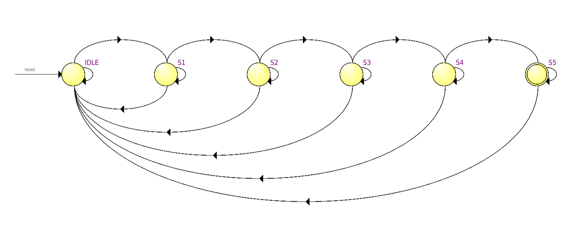
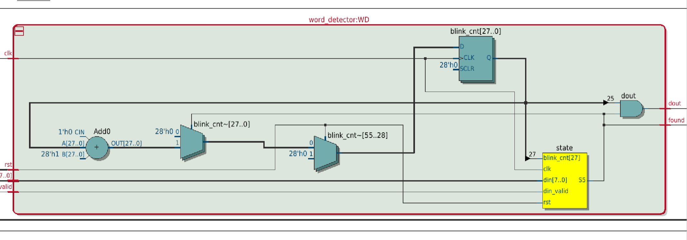
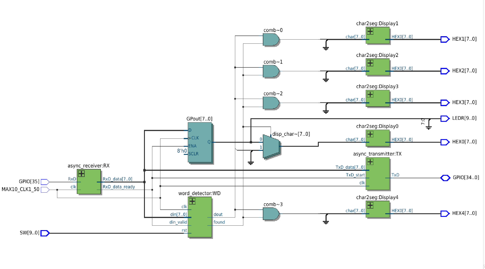
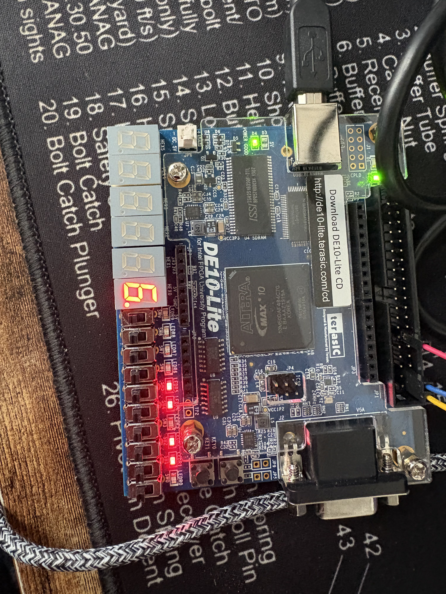
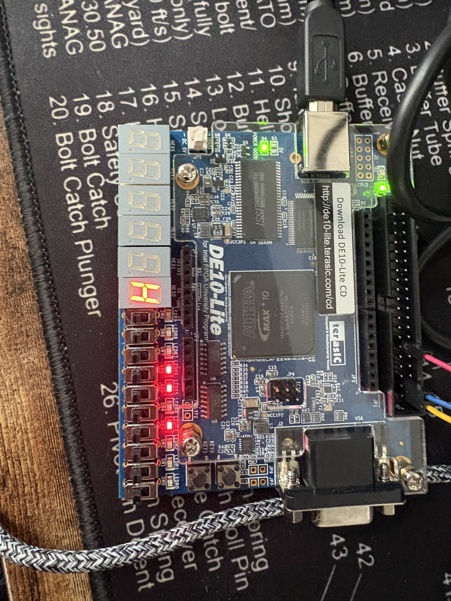
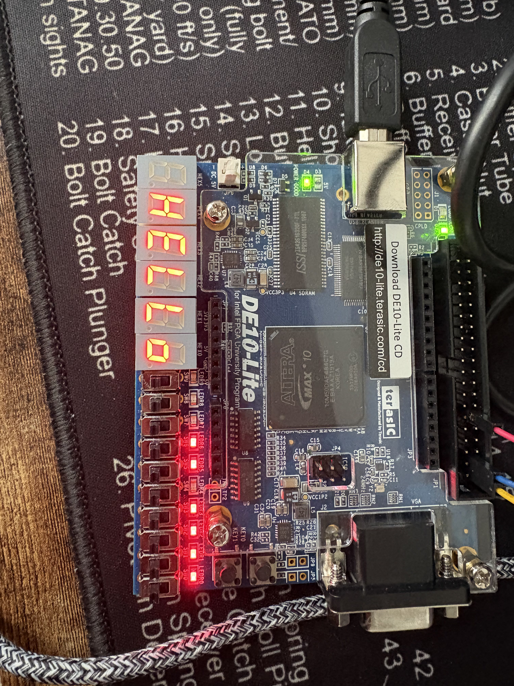

# Lab 6: UART Word Detector FSM

Course: ENCE 3100, Advanced Digital Design
Board: DE10-Lite

Notes:
- SW[9] is the reset. Flip it up, let go, FSM starts clean.
- The serial terminal has to actually send on keystroke with no local line buffering, or the byte timing looks weird on the LEDs.

---

## Overview

The board echoes everything I type over UART: the receiver turns the serial line into bytes, the transmitter sends them straight back, and the last received char shows up on HEX0 with the raw byte on the LEDs. Sitting on that same byte stream is word_detector, an FSM that watches for the word "hello". Get all five letters in a row and it flashes HELLO across all five hex displays a couple times, then resets and goes back to watching. Any wrong letter anywhere in the sequence drops it back to the start.



State diagram: IDLE waits for "h", S1 through S4 each expect one more letter of the word, and any mismatch goes straight back to IDLE. S5 is the flash state, no letters involved, it just sits there blinking until a counter says it's done, then back to IDLE.

---

## The FSM (word_detector.v)

Standard two-block setup. One clocked always block owns the actual registers (state and blink_cnt), and one combinational block figures out next_state. The trick that makes it work is the default assignment next_state = state; before the case statement, the FSM holds still unless a branch explicitly says move. Without that you infer latches and everything gets sad.

The other key piece is din_valid. The receiver holds the last byte on its output for millions of clock cycles between keystrokes, so if the FSM just watched din it would rip through states (or instantly fail on the double "l") off a single keypress. RxD_data_ready pulses high for exactly one clock when a new byte lands, and every transition is gated on that. One keystroke, one transition.

The target letters are parameters (CHAR0 through CHAR4) instead of hardcoded, so changing the word means changing five lines up top, or overriding them when the module is instantiated.

### The blink counter

At 50 MHz, "blink" without a counter means toggling every clock, way too fast to see, just looks dim. So S5 runs a 28-bit counter, and the magic is that the upper bits of a fast counter are just slow square waves for free: bit 25 flips about every 0.67 seconds, which becomes the blink signal. Waiting for bit 27 gives four of those half-periods, i.e. exactly two flashes, then the FSM exits to IDLE and the counter clears.

```verilog
always @(posedge clk) begin
	if(rst) begin
		state <= IDLE;
		blink_cnt <= 0;
	end
	else begin
		state <= next_state;
		if(state == S5)
			blink_cnt <= blink_cnt + 1;
		else
			blink_cnt <= 0;
	end
end
```



Netlist: the state register, a comparator per letter, and the big adder + register pair for blink_cnt. Pretty much what I expected from the source, which was nice to see after Lab 4's counters.

---

## Top level (main.v)

The receiver's data and data_ready outputs feed two consumers: the echo path (transmitter plus the GPout register for HEX0 and the LEDs) and the detector. The display side is a mux per digit. When the detector isn't in the flash state, HEX0 shows the last typed char and HEX1-4 get a value that blanks them, since char2seg defaults to all segments off for anything not in its table. During the flash, the blink signal switches each digit between its letter and blank, so the whole word pulses together.



Top-level netlist: receiver on the left feeding the transmitter, the GPout register, and the detector; five char2seg instances on the display side with the muxes in front of them.

---

## Board verification

Tested by typing in a serial terminal. "hello" flashes HELLO twice and clears. Wrong sequences behave: "hezlo" never leaves the early states, and a stray letter mid-word sends it back to the start. The echo path kept working the whole time since it's independent of the detector.



Normal echo mode, last typed char on HEX0, raw byte on the LEDs.



Mid-sequence, "h" received and echoed. Detector is in S1 waiting for "e".



Match. HELLO lit across all five displays during the flash state.

---

## What I learned

The din_valid strobe is the whole ballgame. Data sitting still on a bus is not the same as new data, and an FSM that can't tell the difference is useless at 50 MHz. That one input is the difference between "one keystroke, one transition" and the FSM shredding through states off a single keypress.

On the structural side: default-assign next_state before the case. One line, kills the inferred latches, makes "stay put" free. And every register gets exactly one always block. I had next_state being written from both blocks and the synthesizer (eventually) yelled about multiple drivers. Splitting "what the value is now" from "what it should be next" felt like extra ceremony at first, but it's what makes the whole thing predictable.

Counter bits are free clock dividers. Didn't need any comparison logic for the blink rate, just picked a bit. That trick alone is going into the permanent toolbox, any time I need a human-speed signal out of a 50 MHz clock, the answer is already counting.

Tooling matters too. default_nettype none is worth it, turned my typo'd wire names into compile errors instead of silent dead signals. And reading the actual error report (main.map.rpt) instead of staring at the console saves a lot of time. Quartus knows exactly where the problem is, it just won't tell you unless you open the right file.

---

## Summary

| Module | Purpose | Reuses |
|---|---|---|
| word_detector.v | 6-state FSM, parameterized target word, timed flash | -- |
| main.v | Top level: UART echo + detector + 5-digit display mux | char2seg.v |
| uart_rx.v / uart_tx.v | UART receiver/transmitter (provided) | -- |
| char2seg.v | ASCII to 7-seg lookup | -- |

If I took this further: scrolling the detected word across the displays instead of flashing a static one, and overlapping matches (right now a wrong letter goes straight to IDLE even if it's an "h" that could start a fresh attempt). Both are small changes on top of the same FSM skeleton.
